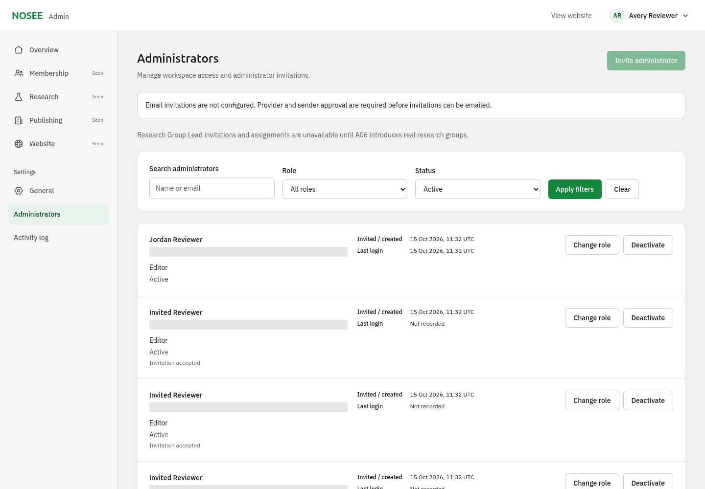
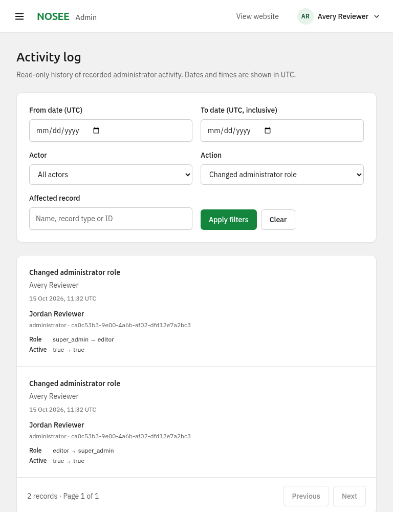
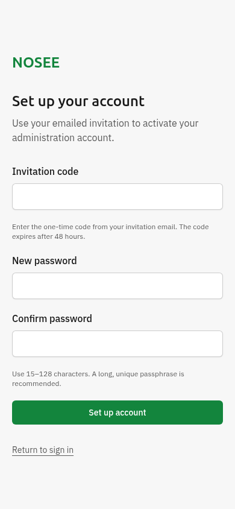

# A02 — Administrator management and Activity log

**Historical A02 handoff · updated 15 October 2026:** core implementation merged as [PR #17](https://github.com/thedanieldiya/nosee-new/pull/17). The [Resend adapter follow-up](../resend-invitations.md) merged as PR #18 (`1204b06`); live delivery/owner acceptance remain pending.

**Original handoff (15 October 2026): provider-independent implementation in review; automated email delivery blocked.** Branch: [`codex/admin-02-administrators-activity`](https://github.com/thedanieldiya/nosee-new/tree/codex/admin-02-administrators-activity), based on main **`f36559c`**, including merged lockfile PR #16. No PR, merge, deployment, Vercel/Neon modification or real email was performed.

## Implemented boundary

- Super-Admin-only `/admin/settings/administrators`: persisted account/invitation directory, literal name/email search, role/status filters and bounded 20-record pagination. Real created/invited timestamps, read-only last login, account access state, invitation expiry/revocation/acceptance and distinct send acceptance/failure/uncertainty. Existing/deactivated emails require explicit account actions; no silent replacement or hard deletion.
- Confirmed role changes and reversible deactivation/reactivation. Self-role/access changes denied; database transaction lock serializes access changes and protects the last active Super Admin. Session deletion **and monotonic access versions** prevent existing or delayed pre-revocation sessions from reviving after reactivation. Fresh authority is checked again inside mutation/read transactions.
- Separate pending invitation records; 256-bit random codes, SHA-256 digest only, 48-hour expiry, one-time transaction-safe redemption, revocation and resend rotation. Anonymous `/admin/accept-invitation` accepts a code and matching 15–128-character passwords via same-origin bounded POST; uses Better Auth scrypt and creates credential/account/audits atomically. It creates no session, does not set `emailVerified`, and provides the existing sign-in destination. Generic signup/recovery endpoints remain closed.
- Neutral mail interface and exact sender-format/HTTPS-origin configuration validation; approved Swiss-style inline-table HTML and equivalent plain text. Code appears only in the in-memory message and invitee's masked POST form, never in URLs, administrator responses or audits. No plaintext outbox/retry payload. Definitive send failure invalidates the token; uncertain acceptance retains a potentially received code until explicit rotation. Stale sends become unconfirmed after two minutes and permit recovery. Provider calls have a ten-second ceiling; crashes leave recoverable persisted state.
- `/admin/settings/activity-log`: real persisted actor/time/action/target, safe captured role/active before/after, actor/action/date/target filters and stable pagination. UTC dates have inclusive end-day semantics. Old A01 events retain genuinely absent target/details. Read-only UI/API, no audit deletion controls.
- Existing Lead access enforcement remains. **New Lead invitations/assignments are rejected server-side and disabled with an A06 explanation.** No application group records, dummy options or invented scope assignments were introduced. Legacy scoped role fixtures exist only in disposable authorization tests.

**Delivery remains unavailable:** `invitationTransport()` returns `null`; Invite and Resend are disabled, and forged requests return 503 without invitation/send/audit writes. There is no manual code-sharing UI, simulated production sender, provider SDK, provider secret or public test transport. The [free-tier proposal](../email-provider-proposal.md) is pending provider/sender/test approval and current official pricing/operational verification (documentation hosts returned 403). Fake sender outcomes in local test screenshots are fixtures, **not real provider acceptance or delivery**.

## Verified results

Validation uses Node 24.19.0, npm 11.9.0, Next 16.4.0 production servers, real PostgreSQL 17 in a loopback-only disposable container, Chromium and axe-core. Random test credentials/codes are mode-0600 files outside Git; no owner's Neon database is connected. Bulk logs/screenshots remain temporary.

| Check | Result |
| --- | --- |
| Clean `npm ci --cache /workspace/.cache/npm --no-fund` | Passed using PR #16 lockfile; no new dependencies or lockfile edits |
| Unit/public tests | **123/123 passed** (including all existing public unit regressions) |
| Isolated database integration | **30/30 passed**: 15 existing A01 plus 15 A02. Includes additive upgrade preserving identities/credential hashes/sessions/audit/bootstrap marker, concurrent single-use redemption, expiry/replay/revoke/resend, duplicate/Lead/scope rejection, missing-provider zero writes, fake acceptance/failure/uncertainty, stale recovery, CSRF/size/rates, role/session/version revocation, two-Super-Admin concurrency, audit-write rollback/privacy, literal search and UTC/pagination boundaries |
| New production browser workflows | **33 axe scans, 222 computed icon/label paint observations; zero violations/runtime errors.** 390/768/1440px, filters/empty/page-two states, disabled email action, A06-disabled role, keyboard confirmation/Escape/focus return, mobile navigation, real deactivate/reactivate and role-change/restore, offline failure, Editor/Lead 403, anonymous activation/password mismatch and real invited Editor sign-in |
| Email browser rendering | **390/600/1440px**, no overflow or axe violations; browser fallbacks only, no claim of Gmail/Outlook-client or inbox verification |
| Existing foundation browser regressions | **67 axe scans, 514 computed icon/label paint observations, 10 workflow records; zero runtime errors.** Includes all three roles at three widths, General save/refresh/password/logout, mobile drawer/focus, forced colors/dark mode, 320px long-name reflow and offline no-false-save |
| Public visual regression | **18 source/target pairs, zero changed pixels**: main baseline vs branch at 390/768/1440px; homepage, About, Events, archive, event detail and 404; identical Chromium/reduced motion/fonts/image decoding |
| Public HTTP routes | Existing event route/meeting 302/HEAD/query/slash/SSR 404 checks passed; no source-content/date-rule changes |
| Public dependency boundary | All **5 public client manifests** exclude admin components, Better Auth and Radix; private CSS remains excluded |
| Typecheck / lint / production build | **All passed on final code** |
| Dependency audit | **0 runtime advisories**; **5 inherited high lint-chain alerts** remain through unpatched `braces`, as tracked in A01. No added dependencies |

Representative screenshots are local test fixtures with addresses masked, not owner data or a substitute for interactive acceptance:

## Migration and review setup

New migration: **`drizzle/0001_administrators_activity.sql`**, with a matching journal entry. Adds invitation/send tables, nullable structured audit fields and default-zero access versions; does not reset/delete/backfill A01 identities, passwords, sessions or the permanent bootstrap marker. Apply only after owner review using the existing explicit migration CLI and an authorized direct connection. Repeated local migrations are safe; build/start do not migrate or bootstrap. Existing A01 code tolerates the additive columns; do not drop this schema or rotate the auth secret as a rollback shortcut.

The branch needs an **owner-approved isolated Preview database**, migration application, unchanged/secure auth secret, and the exact Preview `ADMIN_ORIGIN`. Never attach a branch test suite to the owner's `nosee-db` or let destructive fixtures use it. Existing integration tests guard the exact disposable loopback `nosee_admin01_test` database. `npm run test:admin` runs both database suites sequentially; browser scripts must also run sequentially against their shared fixture DB.

**Preview blocked:** GitHub deployment-status API and Vercel requests returned CONNECT 403. No branch deployment URL was verified. Owner must provide authorized preview configuration/access and the actual URL; this work changes neither main's Production-labelled prelaunch deployment nor its Neon data/settings. Screenshots and localhost testing do not satisfy hosted owner acceptance.

## Owner walkthrough and outstanding acceptance

1. On a safely configured branch preview, sign in as Super Admin; open Administrators, find the actual account, check role/state/last login and use filters. Self changes must be disabled. Confirm unconfigured Invite/Resend show the delivery blocker and Lead is unavailable until A06.
2. With a separately approved isolated existing test account, confirm a role change or deactivate/reactivate; its prior sessions must remain denied and a fresh sign-in must respect its new role. Cancel a confirmation and verify keyboard focus returns to the initiating control.
3. Open Activity log, filter actor/action/record and an inclusive UTC day; paginate. Confirm real safe changes and truthful missing details for A01 entries. Editor and Lead must receive server-side 403 on both pages/APIs.
4. At mobile width, use navigation, filters and confirmation dialogs with keyboard; verify focus, readable wrapping and no horizontal overflow. Screen-reader/voice/magnifier testing remains manual and unclaimed.
5. **After provider/sender/test approval and adapter integration only:** invite an isolated test Editor; verify actual sender, HTML and plain-text arrival, token-free setup URL, one-time activation and real sign-in. Reuse/expired/revoked codes must fail; resend must replace the code and a send failure must never claim success.

**Not yet accepted:** current free/paid terms/operational limits and sender DNS verification; provider integration and approved-inbox delivery/redemption; actual Gmail/Outlook/mobile-mail client rendering (browser rendering alone is insufficient); hosted preview and owner walkthrough; manual assistive technology. A01 Super Admin owner checks remain recorded as passed; Editor owner review depends on approved delivery, scoped Lead on A06. Public launch gates remain separate. No A03 implementation.
